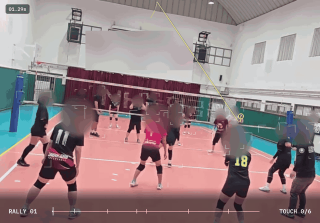

# Volleyball Vision

**한 대의 카메라로 찍은 생활체육 배구 영상에서 랠리와 터치를 찾는 비전 사이드 프로젝트**

Computer Vision · Video Understanding · Sports Analytics

  

엔진이 찾은 랠리 구간과 터치 6개를 고치지 않고 그대로 그린 화면(사람 검수 전). 얼굴과 현수막은 흐리게 처리했다.

> 소개용 저장소다. 코드 · 데이터 · 모델 가중치는 비공개 저장소에 있다.

## 배경

생활체육 경기는 삼각대에 폰 한 대를 세워 찍는다. 찍기는 쉬운데, 한 시간짜리 영상에서 내 플레이를 찾아 돌려 보기는 번거롭다.
영상을 올리면 랠리 단위로 나뉘고 공이 누구에게 닿았는지까지 정리되면 복기가 쉬워진다.
[위볼리](https://github.com/hadan-HwH/wevolley)에 붙일 영상 기능을 위해 그 엔진을 직접 만들어 보는 개인 프로젝트다.

## 파이프라인

| 단계 | 하는 일 | 상태 |
| :--- | :--- | :--- |
| **공 찾기** | 빠르게 움직여 흐려지는 공을 프레임마다 찾아 길로 잇는다 | 동작 |
| **사건 찾기** | 공이 몸에 닿는 순간과 바닥에 떨어지는 순간을 찾는다 | 동작, 학습으로 개선 중 |
| **랠리 나누기** | 서브부터 공이 죽을 때까지를 한 랠리로 묶고 가짜 랠리를 거른다 | 동작, 학습으로 개선 중 |
| **사람 · 코트** | 선수 위치와 코트를 맞춰 위에서 본 자리로 옮긴다 | 동작 |
| **친 사람 · 기술** | 터치마다 누가 쳤는지, 서브 · 리시브 · 토스 · 공격 · 블로킹 중 무엇인지 가린다 | 실험 중 |

## 만드는 방식

- **정답부터 만든다**: 4경기 3.6시간에서 랠리 409개의 시작과 끝을 0.2초 단위로 기록하고, 표본을 사람이 영상으로 다시 검수했다(2026년 10월). 잴 수 없는 개선은 개선이라고 부르지 않는다.
- **처음 보는 경기로 잰다**: 규칙을 다듬는 경기와 채점 전용 경기를 나눈다. 엔진을 바꿀 때마다 같은 채점표로 앞뒤를 비교한다.
- **AI 가 먼저 표시하고 사람이 고친다**: 범용 멀티모달 AI 가 터치 후보를 찍고, 직접 만든 검토 도구에서 사람이 프레임 단위로 확인한다. 검수 전 표시와 검수한 정답은 따로 둔다.
- **범용 AI 와 전용 모델을 비교했다**: 범용 AI 는 장면을 잘 읽지만 터치까지 보면 1시간 경기에 약 10만 원이 든다. 프레임마다 보는 일은 전용 모델이어야 감당된다고 보고 직접 학습하는 쪽을 골랐다.
- **동의한 영상만 쓴다**: 찍힌 사람이 동의한 영상만 학습에 쓰고, 공개하는 장면은 얼굴과 현수막을 흐린다.

  

검토 도구 초기 화면. 터치 후보를 프레임 단위로 확인하고 고친다.

## 상태

연구 프로토타입, 진행 중(2026년 11월). 처음 보는 경기에서 랠리 놓침 3% · 가짜 5% 안쪽, 터치 순간을 프레임 단위로 맞히는 것이 목표다. 정확도 숫자는 사람이 검수한 채점 전용 경기로 잰 것만 공개한다.

## 기술 스택

Python 3.12 · PyTorch · ONNX Runtime · OpenCV · FFmpeg
