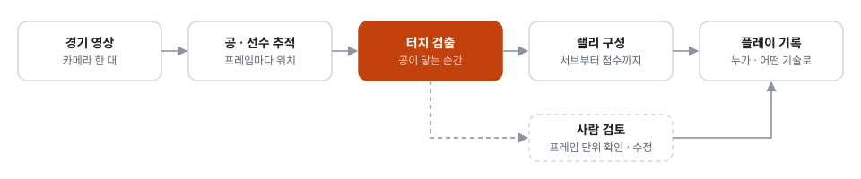
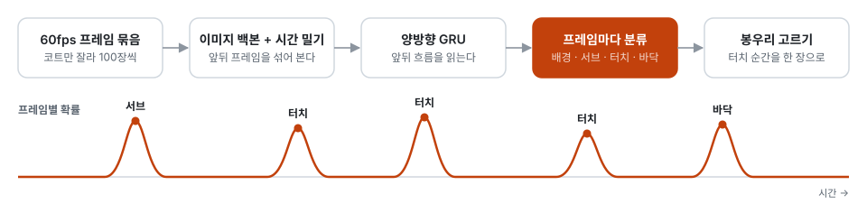

# Volleyball Vision

**한 대의 카메라로 찍은 배구 영상을 랠리와 플레이 단위로 읽어 내는 비전 사이드 프로젝트**

Computer Vision · Video Understanding · Sports Analytics

  

공의 궤적을 따라가며 터치마다 어떤 기술인지 읽고, 랠리의 끝을 잡는다

> 소개용 저장소다. 코드 · 데이터 · 모델은 비공개 저장소에 있다.

## 배경

생활체육 경기는 삼각대에 폰 한 대를 세워 찍는다. 찍기는 쉬운데, 한 시간짜리 영상에서 내 플레이를 찾아 돌려 보기는 번거롭다.
영상을 올리기만 하면 랠리 단위로 나뉘고 누가 어떤 플레이를 했는지까지 정리되도록, 영상 분석 엔진을 직접 만들고 있다.

## 주요 기능

| 기능 | 설명 |
| :--- | :--- |
| **랠리 나누기** | 긴 경기 영상을 서브부터 점수가 날 때까지, 랠리 단위로 자른다 |
| **터치 찾기** | 공이 선수에게 닿는 순간을 프레임 단위로 짚는다 |
| **공 · 선수 추적** | 빠르게 움직이는 공과 코트 위 선수를 따라간다 |
| **플레이 이해** | 터치마다 누가, 어떤 기술로 쳤는지 가린다 |
| **사람 검토** | 분석 결과를 프레임 단위로 확인하고 고치는 도구를 함께 만든다 |

## 기술적 과제

- **공이 빠르고 작다**: 시속 80km 서브는 60fps 로 찍어도 한 장 사이에 37cm 를 움직인다. 화면에서는 흐린 줄무늬로 남는다.
- **터치는 한두 장에만 찍힌다**: 공이 손에 닿는 순간은 60fps 원본에서도 한두 프레임이다. 그 한 장을 놓치면 누가 쳤는지도 틀린다.
- **촬영 조건이 제각각이다**: 방송 중계와 달리 카메라 높이와 각도가 매번 다르고, 선수끼리 가리고, 옆 코트의 공과 사람이 같이 찍힌다.
- **경기가 아닌 시간이 길다**: 올라오는 영상의 3분의 1쯤은 몸풀기와 쉬는 시간이다. 랠리를 찾기 전에 경기 구간부터 가려야 한다.

## 접근 방법

<picture>
  <source media="(prefers-color-scheme: dark)" srcset="assets/flow-dark.svg">
  
</picture>

**1. 공 · 선수 추적**
공은 또렷한 공을 잘 찾는 모델과 흐린 공을 잘 찾는 모델, 두 갈래의 후보를 합쳐 하나의 길로 잇는다. 선수는 화면을 12조각으로 나눠 찾는다. 네트 건너편 선수는 작게 찍혀서 화면 전체를 한 번에 보면 놓치기 때문이다. 코트 네 모서리를 맞춰 선수 위치를 위에서 본 좌표로 옮기고, 관절 17점도 함께 뽑는다.

**2. 터치 검출**
공 길이 꺾이는 곳을 터치로 보는 규칙만으로는 진짜 터치의 3분의 2만 짚었다. 그래서 터치는 영상을 직접 보는 모델(아래 '사건 모델')에 맡긴다.

**3. 랠리 구성**
랠리는 서브로 시작해 공이 바닥에 닿으면 끝난다. 공 길에서 찾은 후보와 사건 모델이 찾은 후보를 합친 뒤, 가짜 랠리(연습 서브, 공 튀기기)를 작은 판정 모델이 거른다. 경기 구간은 코트 양쪽에 선수가 선 시간으로 먼저 나눈다.

**4. 플레이 기록**
터치마다 공 둘레 사람 중 누가 쳤는지를 모델이 고르고, 기술은 배구 규칙으로 먼저 붙인다. 넘어온 공의 첫 터치는 리시브나 디그, 넘기는 터치는 공격, 상대 공격 직후 네트 앞 터치는 블로킹이다. 터치 순간과 쪽만 맞으면 이 규칙만으로 46개 중 44개가 맞는다.

**5. 사람 검토**
결과는 사람이 프레임 단위로 확인하고 고칠 수 있다. 고친 내용은 다시 정답이 되어 다음 학습에 들어간다.

## 모델링

### 사건 모델

<picture>
  <source media="(prefers-color-scheme: dark)" srcset="assets/model-dark.svg">
  
</picture>

- **입력**: 60fps 영상을 줄이지 않고, 코트만 잘라 100장씩 묶어 넣는다.
- **구조**: 가벼운 이미지 백본(RegNetY)의 블록마다 앞뒤 프레임 정보를 섞고(TSM), 양방향 GRU 가 앞뒤 흐름을 읽은 뒤 프레임마다 배경 · 서브 · 터치 · 바닥 중 하나로 가른다.
- **학습**: 백본을 얼리지 않고 끝까지 학습한다. 미리 뽑아 둔 고정 특징으로는 '정확히 어느 프레임인가'를 맞히지 못했다. 사건이 있는 프레임에 5배 무게를 주고, 좌우 반전 · 밝기 · 흐림으로 자료를 늘린다.
- **찾기**: 반씩 겹치는 창으로 영상 전체를 훑어 프레임별 확률을 평균하고, 봉우리를 터치 순간으로 고른다.

### 보조 모델

| 모델 | 하는 일 | 구조 |
| :--- | :--- | :--- |
| **랠리&nbsp;판정** | 랠리 후보가 진짜 랠리인지 가린다 | 랠리 길이, 터치 수, 공이 움직인 폭 같은 특징으로 배우는 작은 판정기 |
| **친&nbsp;사람** | 터치마다 공 둘레 사람 중 한 명을 고른다 | 후보 한 명을 토큰 하나로 본다. 공 기준 위치, 터치 앞뒤 세 장의 관절 17점, 손목과 공의 거리를 넣은 2층 트랜스포머 |
| **공&nbsp;추적** | 흐려진 공까지 프레임마다 찾는다 | 공개된 공 추적 모델에서 출발해 배구 영상에 맞춘다 |

### 설계 결정

- **공개 모델부터 견준다**: 공 · 사람 · 관절 · 코트 · 카메라 움직임 · 소리 · 사건, 일곱 단계에서 공개 모델과 알고리즘 20가지 넘게 같은 시험지로 돌려 보고 출발점을 골랐다.
- **놓치지 않는 쪽으로 합친다**: 새 신호는 후보를 더하는 데만 쓴다. 가짜를 거르는 일은 판정 모델이 따로 맡는다. 판정 모델을 붙이자 시험 경기 두 곳에서 진짜 랠리 비율이 67% → 90%, 50% → 75%로 올랐다.
- **규칙이 되는 곳은 규칙으로**: 기술 분류처럼 배구 규칙으로 풀리는 일은 모델을 만들지 않는다. 모델은 규칙이 틀리는 곳에만 더한다.
- **해상도는 일마다 다르게**: 공은 화면 전체를 줄여서 찾는다. 원본을 조각내 찾아 보니 9배 느려지기만 하고 결과는 나아지지 않았다. 사람 · 관절 · 사건은 원본 해상도를 그대로 쓴다.
- **범용 AI 대신 전용 모델**: 범용 멀티모달 AI 는 장면을 잘 읽지만, 터치까지 보게 하면 1시간 경기에 약 10만 원이 든다. 프레임 한 장을 보는 값이 전용 모델의 수백 배라서, 프레임마다 보는 일은 전용 모델로 직접 학습한다.

## GPU 학습

- **GPU 가 필요하다**: 프레임마다 영상을 직접 보는 모델이라 CPU 로는 학습이 끝나지 않는다.
- **A10 한 대를 빌려 썼다**: 시간 단위로 빌려 5시간쯤 학습해 봤다.
- **끊겨도 이어 간다**: 에폭마다 이어 하기 점을 남겨, 빌린 서버가 멈춰도 같은 명령으로 그 자리부터 다시 돈다.

## 데이터와 평가

- **AI 가 먼저 표시하고 사람이 검수한다**: 범용 멀티모달 AI 가 0.1초 간격 장면에서 터치 자리를 고르고, 그 앞뒤만 60fps 로 확대해 닿는 순간을 찍는다. 사람이 검수한 경기와 견주면 랠리의 99.3%, 터치의 97.9%를 같은 자리에서 찾는다.
- **채점용 경기는 학습에 넣지 않는다**: 사람이 끝까지 검수한 경기는 채점에만 쓴다. 미리 본 문제로 매긴 점수는 믿지 않는다.
- **같은 채점표로 앞뒤를 견준다**: 엔진을 바꿀 때마다 고정된 채점표를 다시 돌려, 숫자로 확인된 개선만 남긴다. 터치는 정답과 0.3초 안이면 맞은 것으로 센다.

  

검토 도구 · 분석 결과를 프레임 단위로 확인하고 고친다

## 결과

| 항목 | 결과 |
| :--- | :--- |
| **처음 보는 경기에서 찾은 랠리** | 84% |
| **처음 보는 경기에서 찾은 터치** | 85% |
| **친 사람 맞힘** | 가장 가까운 사람 고르기 66% → 모델 82% |
| **가짜 랠리 거르기** | 진짜 랠리 비율 67% → 90%, 50% → 75% (시험 경기 두 곳) |
| **AI 표시와 사람 검수의 일치** | 랠리 99.3% · 터치 97.9% |

랠리 · 터치는 엔진이 혼자 분석한 결과를 사람이 검수한 4경기와 견준 값이고, 친 사람은 학습에 쓰지 않은 영상의 터치 1,606개 기준이다.

## 기술 스택

Python · PyTorch · ONNX Runtime · OpenCV · FFmpeg
